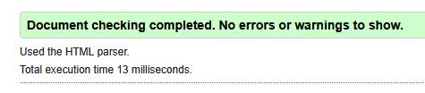
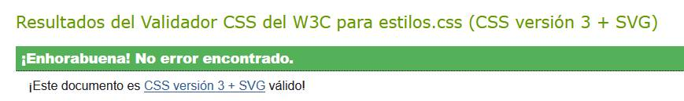
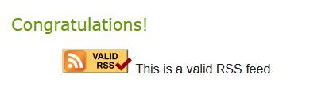

"# toyota-supra" 
# TOYOTA SUPRA

## 1. Descripción del proyecto

Toyota Supra es una página web educativa dedicada
a la historia y evolución del Toyota Supra.

El proyecto contiene información sobre sus generaciones,
motores, características técnicas y evolución.

## 2. Autoría

- Autor: Antonio Ángel Coba Sánchez
- Curso: Tu curso
- Módulo: LMSGI
- Año: 2026

## 3. Enlaces

- Web publicada:
  https://aancosa08.github.io/toyota-supra/

- Repositorio:
  https://github.com/aancosa08/toyota-supra

## 4. Estructura del proyecto

- index.html: página principal.
- blog.html: historia y evolución del Supra.
- tabla.html: comparativa técnica de generaciones.
- galeria.html: imágenes y contenido multimedia.
- formulario.html: encuesta sobre el Toyota Supra.
- rss.xml: canal de novedades RSS.
- css/estilos.css: hoja de estilos compartida.
- img/: fotografías, logotipo e ilustraciones.
- audio/: archivos de audio.
- video/: archivos de vídeo.
- subtitulos/: subtítulos en español e inglés.

## 5. Validación

### HTML

### CSS

### RSS

## 6. Decisiones técnicas

Se ha utilizado HTML5 para estructurar el contenido
y CSS para diseñar la presentación de las páginas.

Se ha empleado una hoja de estilos compartida
por las cinco páginas.

Se han utilizado diferentes formatos de imágenes:
JPG, WebP, PNG y SVG.

También se han utilizado elementos multimedia
como audio, vídeo y subtítulos.
